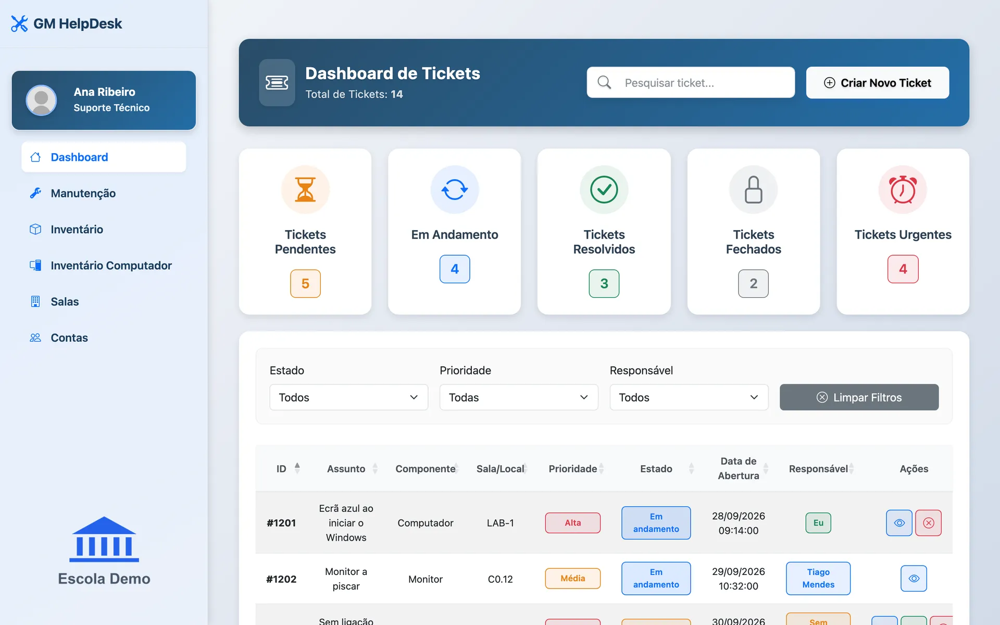
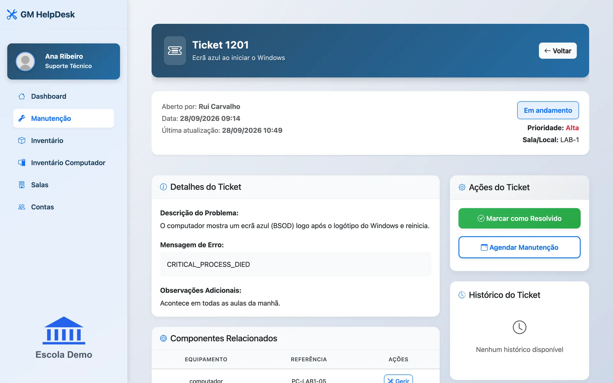
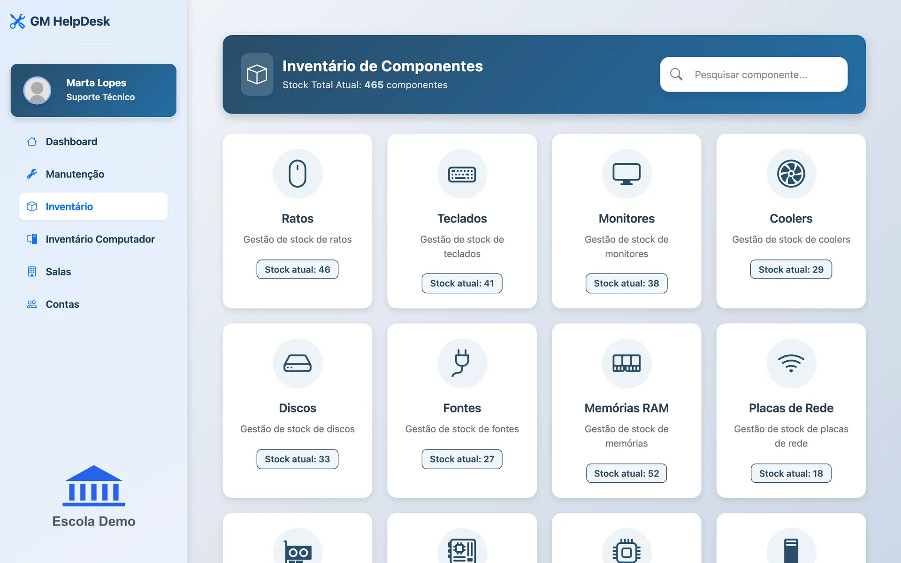
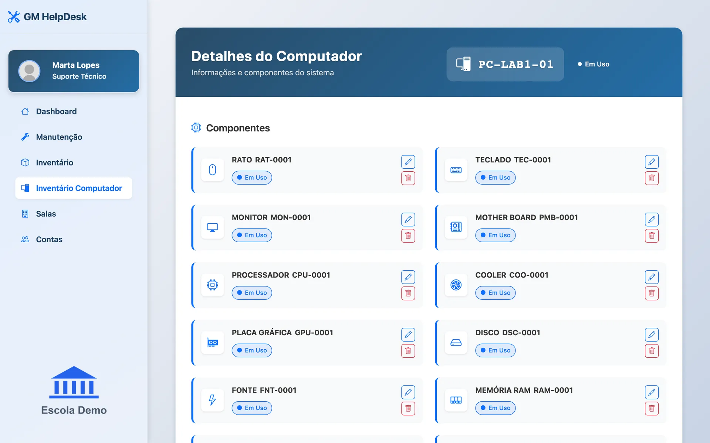
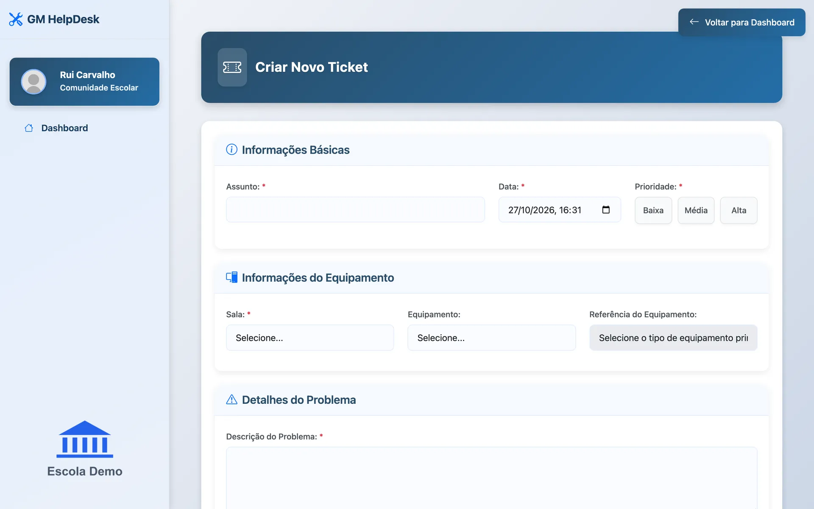
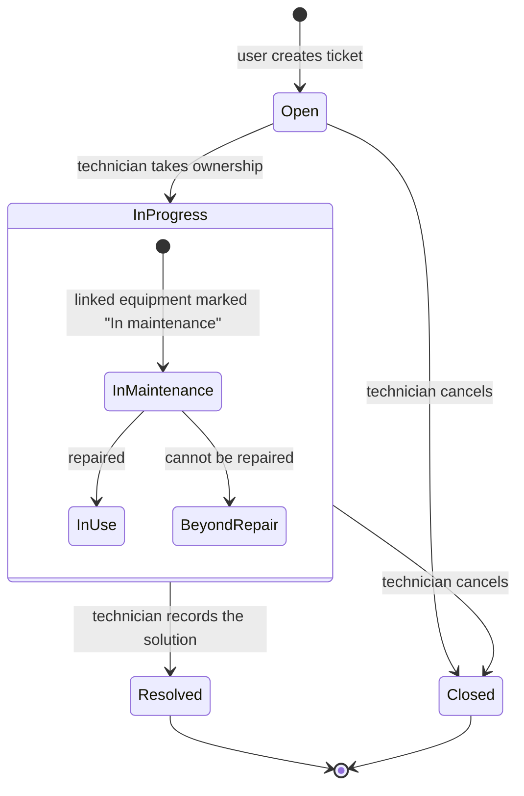

# GM HelpDesk

**A web platform for a school's IT support: students, teachers and staff report equipment problems, and the technical team manages tickets, repairs and the whole hardware inventory.**



> Final course project (PAP), built solo, graded 20/20.
> The interface is in Portuguese. All data shown in this repository is fictional.

## Features

**Support tickets**
- Users open a ticket tied to a room, a computer or a specific component, with priority (high / medium / low), error message, notes and file attachments.
- Technicians take ownership of a ticket, comment on it and move it through its states; every change is written to the ticket history.

**Maintenance workflow**
- When a ticket references a piece of equipment, that equipment is automatically marked as *In maintenance*.
- Resolving the ticket puts it back *In use*, or marks it as *Beyond repair*. Technicians can also schedule a maintenance date.

**Hardware inventory**
- Full create / read / update / delete for **14 component types**: mice, keyboards, monitors, coolers, disks, power supplies, RAM, network cards, graphics cards, motherboards, processors, cases, DVD drives and fans.
- Each type has its own catalogue (brands, models, sockets, capacities…) and a state (available, in use, in maintenance, beyond repair).
- Computers are assembled from these components and assigned to rooms; each room shows the equipment it holds.

**Accounts and access**
- Two account types with different dashboards and menus: **school community** (students, teachers, staff) and **technical support**.
- Technicians manage accounts. New users must change their password on first login; forgotten passwords are reset through a single-use, 24-hour token sent by email.

**Email notifications** (PHPMailer over SMTP)
- New ticket (to the technical team), confirmation (to the requester), status updates, welcome emails for new accounts and password recovery.

<table>
  <tr>
    <td></td>
    <td></td>
  </tr>
  <tr>
    <td></td>
    <td></td>
  </tr>
</table>

## Stack and architecture

| Layer | Technology |
|---|---|
| Backend | PHP 8 (PDO with prepared statements, sessions, bcrypt password hashing) |
| Database | MySQL / MariaDB: relational model with 88 tables |
| Frontend | HTML, CSS, JavaScript, jQuery, AJAX (Fetch), Bootstrap 5, DataTables |
| Email | PHPMailer (SMTP), installed with Composer |
| Local environment | Docker Compose: PHP 8.3 + Apache, MariaDB 10.6, Mailpit |

The app is a classic server-rendered PHP application: each page is a PHP script, and actions such as saving a component or changing a ticket's state are small PHP endpoints called with AJAX that return JSON.

### Ticket lifecycle



## Run it locally

Requirements: [Docker](https://www.docker.com/) with Docker Compose.

```bash
git clone https://github.com/rafaaduarte06/gm-helpdesk.git
cd gm-helpdesk
docker compose up --build
```

- App: http://localhost:8080
- Emails sent by the app: http://localhost:8025 (Mailpit catches every email, nothing leaves your machine)

On the first start, the database is created from `database/schema.sql` and filled with fictional data from `database/seed.sql`.

### Demo users

These accounts exist **only in the local demo database** and use a demo password.

| Role | Login as | Email | Password |
|---|---|---|---|
| Administrator (technical support) | Suporte Técnico | `marta.lopes@escola-demo.example` | `Demo2026!` |
| Technician | Suporte Técnico | `ana.ribeiro@escola-demo.example` | `Demo2026!` |
| User (teacher) | Comunidade Escolar | `rui.carvalho@escola-demo.example` | `Demo2026!` |

On the login page, pick the account type first and then enter the full email.

In the code, access control is by account type: the administrator is a technician account in the *administrator* department and has the same permissions as other technicians.

### Without Docker

Any PHP 8 + MySQL/MariaDB host works: import `database/schema.sql` and `database/seed.sql`, copy `app/config.example.php` to `app/config.local.php`, fill in the database and SMTP settings, run `composer install` inside `app/`, and point the web server to the `app/` folder.

## Tests

There are no automated tests. The project was tested manually during development.

## Technical decisions and what I learned

- **Prepared statements everywhere** (PDO) to prevent SQL injection, and `password_hash` / `password_verify` for passwords.
- **A normalised catalogue per component type**: more tables, but each component type can have its own attributes and states, and the dropdowns are driven by the database.
- **Equipment state follows the ticket**: tying the maintenance workflow to the inventory taught me to keep several tables consistent through one user action.
- **What I would do differently today:** use a small framework or router instead of one PHP file per action, add CSRF protection and foreign keys, validate uploaded file types more strictly, and write automated tests.

## Project structure

```
app/          PHP application (web root)
database/     schema.sql (structure only) and seed.sql (fictional data)
docker/       Dockerfile and PHP settings for the local environment
docs/images/  screenshots used in this README
```

## Third-party

- [PHPMailer](https://github.com/PHPMailer/PHPMailer) is licensed under LGPL-2.1 and installed with Composer (it is not included in this repository).
- Bootstrap, Bootstrap Icons, jQuery, DataTables, Toastify and SweetAlert2 are loaded from public CDNs and keep their own licenses.

## License

My own code is released under the [MIT License](LICENSE).

---

Made by **Rafael Soares Duarte**. Portfolio: https://rafael-soares-duarte.vercel.app
